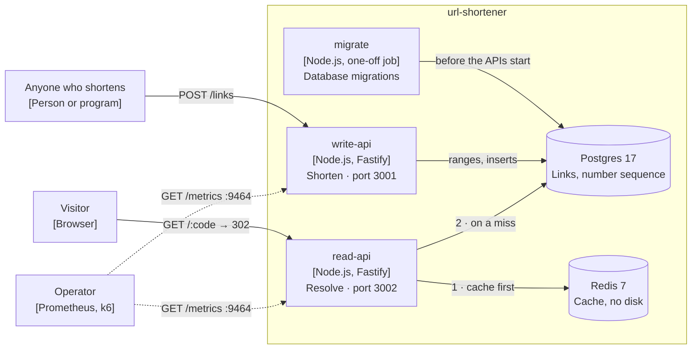

# url-shortener

[](https://github.com/poschuler/url-shortener/actions/workflows/ci.yml)

A URL shortener built with Node.js, TypeScript and Fastify: a modular monolith with hexagonal architecture, used as a reference project for posts on [poschuler.com](https://poschuler.com).

> **Status: work in progress.** Shorten and Resolve work end to end, with an OpenAPI reference, Prometheus metrics and a load test. Some architecture decision records are still to be written.

## What it does

- **Shorten**: turns a Target URL into a Short URL with a seven-character, case-sensitive Short Code.
- **Resolve**: redirects a Visitor who follows a Short URL to its Target URL.

## Architecture

Writes and reads run as separate processes built from the same codebase: `write-api` for Shorten and `read-api` for Resolve ([ADR-0014](docs/adr/0014-writes-and-reads-run-as-separate-processes-from-one-codebase.md)). For development, `api` runs both in one process.



- **Shorten** validates the Target URL, takes a number that `write-api` reserved from a Postgres sequence a range at a time ([ADR-0010](docs/adr/0010-short-code-numbers-are-handed-out-in-ranges.md)), turns it into a Short Code with a keyed Feistel permutation ([ADR-0004](docs/adr/0004-keyed-feistel-permutation-for-short-codes.md)) and saves the Link.
- **Resolve** reads the Target URL from Redis, falls back to Postgres on a miss, and caches Short Codes without a Link too ([ADR-0017](docs/adr/0017-resolve-reads-through-a-redis-cache-with-negative-entries.md)). It redirects with 302 ([ADR-0016](docs/adr/0016-resolve-redirects-with-302.md)).

Inside, each module is hexagonal: its use cases and domain do no I/O and reach Postgres and Redis through ports, and dependency-cruiser enforces the layers ([ADR-0009](docs/adr/0009-dependency-boundaries-are-enforced-with-dependency-cruiser.md)). [`docs/architecture.md`](docs/architecture.md) has the three levels of the C4 model, down to the components of the `links` module, and both paths step by step.

## Documentation

- [`docs/architecture.md`](docs/architecture.md): context, containers and components, with diagrams.
- [`CONTEXT.md`](CONTEXT.md): the domain language (Link, Short Code, Target URL, Short URL, Visitor).
- [`docs/adr/`](docs/adr/): architecture decision records, numbered in the order they were made.
- [`docs/openapi.json`](docs/openapi.json): the OpenAPI 3.1 document of the API, generated from the routes. With `DOCS_ENABLED=true`, each API also serves it at `/docs/openapi.json`, with a [Scalar](https://scalar.com) reference at `/docs`.

## Requirements

- Node.js 24 or later
- pnpm 11
- Docker, for integration tests, end-to-end tests and the local stack

## Getting started

```bash
pnpm install
cp .env.example .env
openssl rand -hex 16   # paste the result into SHORT_CODE_KEY in .env
pnpm check
```

`SHORT_CODE_KEY` is the secret key of the permutation that turns numbers into Short Codes. The one in `.env.example` is public: with it, anyone can turn a Short Code back into its number and count the Links. Keep your own secret, and never change it once Links exist: a new key maps new numbers onto Short Codes that may already be taken.

To run the whole stack, see [Docker](#docker). To work on the code, run Postgres and Redis from the stack and the all-in-one `api` from `src/`:

```bash
docker compose up -d --wait postgres redis
pnpm db:migrate
pnpm dev   # api on port 3000
```

The Short URLs that `api` returns point to `PUBLIC_BASE_URL`, which `.env.example` sets to `read-api`. To follow them with `pnpm dev`, set `PUBLIC_BASE_URL=http://localhost:3000`.

## API

| Route          | Served by          | Answers                                                                                              |
| -------------- | ------------------ | ---------------------------------------------------------------------------------------------------- |
| `POST /links`  | `write-api`, `api` | 201 with the `code` and the `shortUrl` for the `url` in the body; 400 for an invalid Target URL; 429 |
| `GET /:code`   | `read-api`, `api`  | 302 to the Target URL; 400 for a malformed Short Code; 404 when no Link has it; 429                  |
| `GET /health`  | every API          | 200 while the process is up                                                                          |
| `GET /ready`   | every API          | 200 when its dependencies are ready, 503 naming the ones that are not                                |
| `GET /docs`    | every API          | The API reference, only with `DOCS_ENABLED=true`                                                     |
| `GET /metrics` | every API          | Prometheus metrics, on `METRICS_PORT` only (see [Metrics](#metrics))                                 |

Errors are [Problem Details](https://www.rfc-editor.org/rfc/rfc9457) (`application/problem+json`). Every response carries an `x-request-id` header, the one the request sent or a new one, and the logs use the same id.

`write-api` is ready once Postgres answers and it has reserved its first range of numbers. `read-api` is ready once Postgres answers: without Redis it still resolves, from Postgres.

```bash
curl -i localhost:3001/links -H 'content-type: application/json' -d '{"url":"https://example.com"}'
curl -i localhost:3002/<code>   # the code from the response: 302 to https://example.com
```

## Configuration

Each process reads its variables from the environment, or from `.env` with `pnpm dev`, `pnpm start` and the scripts. It validates only the ones it uses and refuses to start when one is missing or invalid.

| Variable                     | Default                                 | Used by            | What it does                                                                                                                                                             |
| ---------------------------- | --------------------------------------- | ------------------ | ------------------------------------------------------------------------------------------------------------------------------------------------------------------------ |
| `NODE_ENV`                   | `development`                           | every API          | `development`, `test` or `production`                                                                                                                                    |
| `PORT`                       | 3000 (`api`), 3001 (write), 3002 (read) | every API          | Port of the API                                                                                                                                                          |
| `LOG_LEVEL`                  | `info`                                  | every process      | pino log level, from `fatal` to `trace`, or `silent`                                                                                                                     |
| `METRICS_PORT`               | 9464                                    | every API          | Port of `/metrics`, apart from the API                                                                                                                                   |
| `PG_HOST`                    | required                                | every process      | Postgres host                                                                                                                                                            |
| `PG_PORT`                    | 5432                                    | every process      | Postgres port                                                                                                                                                            |
| `PG_USER`, `PG_PASSWORD`     | required                                | every process      | Postgres credentials                                                                                                                                                     |
| `PG_NAME`                    | required                                | every process      | Postgres database                                                                                                                                                        |
| `SHORT_CODE_KEY`             | required                                | `write-api`, `api` | 32 hexadecimal characters: the secret key of the Short Codes (see [Getting started](#getting-started))                                                                   |
| `PUBLIC_BASE_URL`            | required                                | `write-api`, `api` | Base of the Short URLs. A Target URL on its hostname is rejected, so a Short URL cannot point to another one                                                             |
| `MAX_URL_LENGTH`             | 2048                                    | `write-api`, `api` | Longest Target URL accepted, in its canonical form                                                                                                                       |
| `SHORTEN_RATE_LIMIT_MAX`     | 20                                      | `write-api`, `api` | `POST /links` requests per client IP in each window                                                                                                                      |
| `RESOLVE_RATE_LIMIT_MAX`     | 300                                     | `read-api`, `api`  | `GET /:code` requests per client IP in each window                                                                                                                       |
| `RATE_LIMIT_WINDOW_MS`       | 60000                                   | every API          | Window of both rate limits. The limits are kept in memory, per process ([ADR-0015](docs/adr/0015-routes-are-rate-limited-per-client-ip-in-each-process.md))              |
| `TRUST_PROXY`                | empty                                   | every API          | Comma-separated addresses or CIDR ranges of the reverse proxies, or `loopback`, `linklocal`, `uniquelocal`. The client IP comes from `X-Forwarded-For` only through them |
| `DOCS_ENABLED`               | `false`                                 | every API          | Serves the API reference at `/docs`                                                                                                                                      |
| `REDIS_HOST`                 | `localhost`                             | `read-api`, `api`  | Redis host                                                                                                                                                               |
| `REDIS_PORT`                 | 6379                                    | `read-api`, `api`  | Redis port                                                                                                                                                               |
| `REDIS_PASSWORD`             | required                                | `read-api`, `api`  | Redis password                                                                                                                                                           |
| `CACHE_TTL_SECONDS`          | 86400                                   | `read-api`, `api`  | How long a Target URL stays cached                                                                                                                                       |
| `CACHE_NEGATIVE_TTL_SECONDS` | 60                                      | `read-api`, `api`  | How long a Short Code without a Link stays cached                                                                                                                        |

## Scripts

| Script                              | What it does                                                                             |
| ----------------------------------- | ---------------------------------------------------------------------------------------- |
| `pnpm check`                        | Format check, lint, type check, dependency boundaries and tests with coverage thresholds |
| `pnpm test`                         | Runs the unit tests once                                                                 |
| `pnpm test:watch`                   | Runs the unit tests on every change                                                      |
| `pnpm test:coverage`                | Runs the unit tests with a coverage report in `coverage/`                                |
| `pnpm test:integration`             | Runs the integration tests against Postgres and Redis in containers (needs Docker)       |
| `pnpm test:e2e`                     | Runs the end-to-end tests against the running compose stack                              |
| `pnpm lint` / `pnpm lint:fix`       | Lints with oxlint, optionally fixing what it can                                         |
| `pnpm format` / `pnpm format:check` | Formats with oxfmt, or only checks                                                       |
| `pnpm typecheck`                    | Type checks sources, tests and config files                                              |
| `pnpm deps:check`                   | Checks module and layer boundaries with dependency-cruiser                               |
| `pnpm openapi`                      | Regenerates `docs/openapi.json` from the routes                                          |
| `pnpm build`                        | Compiles `src/` to `dist/`                                                               |
| `pnpm dev`                          | Runs the all-in-one API from `src/`, restarting on every change                          |
| `pnpm start`                        | Runs the compiled all-in-one API from `dist/` (run `pnpm build` first)                   |
| `pnpm db:migrate`                   | Applies the pending database migrations to the Postgres in `.env`                        |
| `pnpm db:migrate:down`              | Reverts the last applied migration                                                       |

## Docker

`compose.yaml` runs `write-api` and `read-api` from the same image, both with health checks, plus Postgres 17 and Redis 7. It reads its values from `.env`. A one-off `migrate` service applies the database migrations first; the APIs start only if it succeeds:

```bash
docker compose up -d --build --wait --remove-orphans
docker compose down
```

`--remove-orphans` removes containers of services that are no longer in `compose.yaml`, such as an older all-in-one `api`. `docker compose down -v` also deletes the Postgres volume.

Redis is a cache only: it keeps no data on disk and, once it reaches its memory limit, evicts the least recently used keys. Postgres and Redis are also published on `127.0.0.1`, so `pnpm dev` can use them from the host. To revert the last migration inside the stack:

```bash
docker compose run --rm migrate node dist/entrypoints/migrate.js down
```

The `Dockerfile` builds a production image that runs as the non-root `node` user. By default it starts the all-in-one `api`; the compose stack overrides the command for `migrate`, `write-api` and `read-api`. To run it on its own:

```bash
docker build -t url-shortener .
docker run --rm -p 3000:3000 --env-file .env url-shortener
curl -i localhost:3000/health
```

`docker run --env-file` keeps quotes as part of the value, so keep the values in `.env` unquoted. The container shuts down gracefully on `SIGTERM` (`docker stop`).

## Metrics

Each API serves Prometheus metrics at `/metrics` on a port of its own, `METRICS_PORT` (9464 by default), never on its public port. The stack publishes them on `127.0.0.1` only: `write-api` on port 9464 and `read-api` on port 9465.

```bash
curl -s localhost:9464/metrics | grep http_request_duration_seconds_count
```

Besides the Node.js process metrics, they include:

- `http_request_duration_seconds`: every request, by `method`, `route` (the route pattern, or `unmatched`) and `status_code`.
- `links_cache_lookups_total`: cache reads in `read-api`, by `result` (`hit`, `known-missing` or `miss`). A Redis failure counts as a `miss`.
- `links_db_query_duration_seconds`: Postgres queries, by `operation` (`allocate_range`, `save_link` or `find_target_url`) and `outcome` (`ok` or `error`).

## Load testing

`test/load/resolve-link.ts` is a [k6](https://grafana.com/docs/k6/) script for the read path. It runs in the `k6` service of the compose stack, from the `grafana/k6` image, so nothing has to be installed. It first creates 1000 links, then asks `read-api` for them at a fixed rate: 500 requests per second for one minute, a tenth of them for Short Codes without a Link.

The stack has to be up with raised rate limits, because every request comes from the same IP. Variables set in the shell take precedence over `.env`:

```bash
SHORTEN_RATE_LIMIT_MAX=100000 RESOLVE_RATE_LIMIT_MAX=10000000 docker compose up -d --build --wait
docker compose run --rm k6
docker compose run --rm -e RATE=1000 -e DURATION=30s k6   # another rate or duration
docker compose up -d --wait                               # back to the limits in .env
```

k6 exits with an error when more than 1% of the requests fail or when the 95th and 99th percentiles go past 100 ms and 250 ms. The thresholds are loose on purpose: they catch a broken cache or a wall of 429s, not a slower machine. After a run, the metrics of `read-api` show the cache hit ratio and the time spent in Postgres:

```bash
curl -s localhost:9465/metrics | grep -E '^links_'
```

## Continuous integration

GitHub Actions runs `pnpm check`, the integration tests, and the end-to-end tests against the compose stack on every push to `main` and on every pull request (`.github/workflows/ci.yml`). `pnpm check` includes a test that fails when `docs/openapi.json` no longer matches the routes: run `pnpm openapi` and commit the result.

## Project layout

```
src/
  modules/<module>/   one hexagonal module per bounded area (domain, application, infrastructure, http)
  shared/             code shared across modules; never imports from modules/
  entrypoints/        one composition root per process
test/
  unit/               mirrors src/
  integration/
  contract/
  e2e/
  load/               k6 scripts
docs/
  architecture.md     C4 diagrams
  adr/                architecture decision records
  openapi.json        the OpenAPI document, generated
```

## License

MIT
