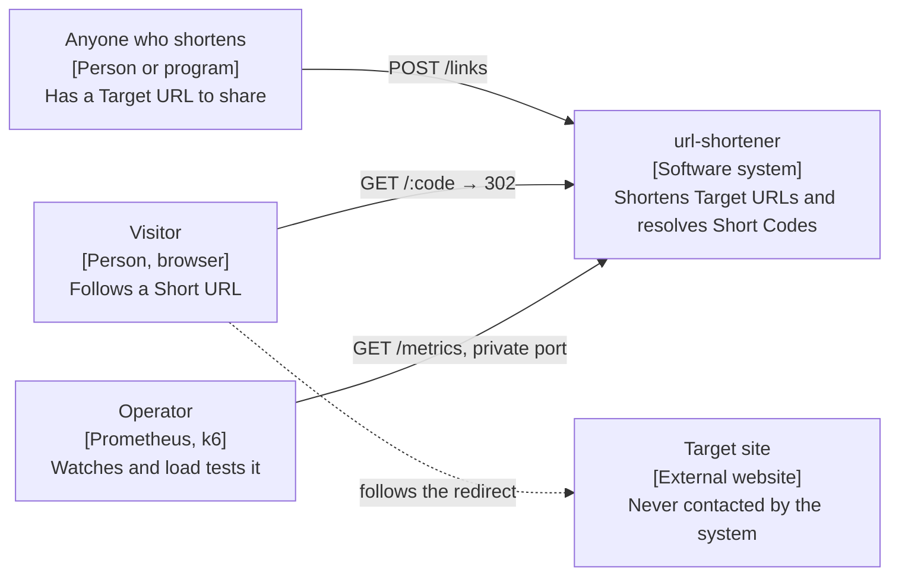
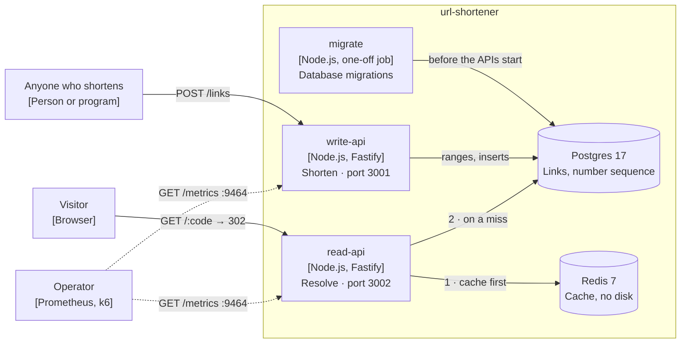
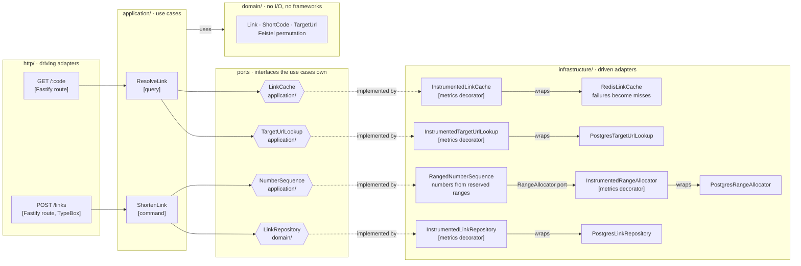

# Architecture

The system at three levels of the [C4 model](https://c4model.com): its context, its containers and the components of the `links` module. The diagrams are Mermaid, so GitHub draws them and they change with the code. The words in them (Link, Short Code, Target URL, Short URL, Visitor) are defined in [`CONTEXT.md`](../CONTEXT.md).

## Level 1: Context

- Anyone can shorten a URL: there are no accounts and no authentication, and the system does not record who shortened what ([ADR-0003](adr/0003-shortening-is-open-without-authentication.md)).
- The system never contacts a Target URL, not even to validate it ([ADR-0005](adr/0005-target-url-validation-never-contacts-the-target-url.md)). Only the Visitor's browser reaches the Target site, by following the redirect.
- The operator scrapes metrics from a port of their own, which is not published with the API, and load tests the read path with k6.

## Level 2: Containers

- `write-api` and `read-api` are separate processes built from the same codebase and the same image, so each side scales on its own ([ADR-0014](adr/0014-writes-and-reads-run-as-separate-processes-from-one-codebase.md)). For development, the all-in-one `api` serves both sides in one process, on port 3000.
- `write-api` needs no Redis. It reserves Short Code numbers from a Postgres sequence a range at a time, so most Shorten requests take a number without asking the database ([ADR-0010](adr/0010-short-code-numbers-are-handed-out-in-ranges.md), [ADR-0011](adr/0011-a-postgres-sequence-allocates-the-ranges.md)).
- `read-api` reads Target URLs through Redis and falls back to Postgres on a miss. It also caches Short Codes without a Link for a short time. When Redis is down or slow, Resolve keeps working from Postgres ([ADR-0017](adr/0017-resolve-reads-through-a-redis-cache-with-negative-entries.md)).
- `migrate` applies the database migrations with Kysely and exits; the APIs start only if it succeeds ([ADR-0012](adr/0012-kysely-for-sql-and-migrations.md)).
- Each API process rate limits its routes per client IP, in memory ([ADR-0015](adr/0015-routes-are-rate-limited-per-client-ip-in-each-process.md)), and serves `/metrics` on a second port, 9464 inside the container.

## Level 3: Components of the `links` module

The module is hexagonal. The use cases and the domain do no I/O and know no frameworks: they talk to the outside through ports, which are interfaces the use cases own. Adapters on the left drive the use cases, and adapters on the right implement the ports.

The dotted arrows read "implemented by" so the diagram flows from left to right. In the code, the dependency points the other way: each adapter imports the interface of its port, and nothing in `application/` or `domain/` imports an adapter.

### Layers

| Folder            | Holds                                                                                                                      | May import                                         |
| ----------------- | -------------------------------------------------------------------------------------------------------------------------- | -------------------------------------------------- |
| `domain/`         | `Link`, the `ShortCode` and `TargetUrl` value objects, their errors, the Feistel permutation and the `LinkRepository` port | nothing outside `domain/`, except `shared/domain/` |
| `application/`    | The `ShortenLink` and `ResolveLink` use cases and their ports                                                              | `domain/` and `shared/domain/`                     |
| `infrastructure/` | Postgres and Redis adapters, the ranged number sequence, the metrics decorators and in-memory fakes for tests              | anything but `http/`                               |
| `http/`           | The Fastify routes and the mapping from errors to Problem Details                                                          | anything but `infrastructure/`                     |
| `index.ts`        | The composition: `createLinksWriteModule` and `createLinksReadModule`                                                      | anything in the module                             |

dependency-cruiser checks these rules in `pnpm check`, along with two more: a module reaches another module only through its `index.ts`, and `src/shared/` never imports a module. Only the entrypoints may import from anywhere ([ADR-0009](adr/0009-dependency-boundaries-are-enforced-with-dependency-cruiser.md)).

### Where the ports live

`LinkRepository` saves a `Link`, the domain's own entity, so it sits in `domain/` next to it. The other three ports exist for the use cases, not for the domain: `NumberSequence` hands out numbers to `ShortenLink`, and `LinkCache` and `TargetUrlLookup` return plain data to `ResolveLink`. They live in `application/ports.ts`. Resolve reads a Target URL as a string instead of rebuilding a `Link`, because it enforces no rule ([ADR-0008](adr/0008-shorten-goes-through-the-domain-resolve-reads-through-a-query-port.md)).

`RangeAllocator` is a port inside `infrastructure/`: `RangedNumberSequence` hands out numbers from ranges, and only asks Postgres for a new range through it. It keeps the sequence logic testable without a database.

### Metrics decorators

Each port that reaches Redis or Postgres is wrapped in an `Instrumented*` decorator. It implements the same interface, delegates to the real adapter and records the result: cache reads by result, and the time of each query by operation and outcome. The use cases and the adapters do not know about metrics. `index.ts` puts each decorator around its adapter.

### Composition

`index.ts` exposes two functions, and the entrypoints in `src/entrypoints/` call the ones they need:

- `createLinksWriteModule` wires `ShortenLink` with the ranged sequence and the Postgres repository, and registers `POST /links`. `write-api` and `api` call it.
- `createLinksReadModule` wires `ResolveLink` with the Redis cache and the Postgres lookup, and registers `GET /:code`. `read-api` and `api` call it.

Both receive their metrics from the entrypoint, which creates them once per process, so `api` can compose both sides in one metrics registry.

### Tests

The use cases are tested against in-memory fakes of their ports, with no database. The fakes of the cache, the Target URL lookup and the range allocator pass the same contract tests as their real adapters, in `test/contract/`, so they cannot drift from what they stand for. The Postgres and Redis adapters are tested against real containers, and the compose stack end to end ([ADR-0006](adr/0006-tests-live-in-a-separate-tree-split-by-kind.md)).

## Shorten, step by step

1. `POST /links` checks the body against its TypeBox schema ([ADR-0013](adr/0013-fastify-with-typebox-for-http.md)).
2. `ShortenLink` parses the Target URL into its canonical form and checks its rules before anything else, so an invalid URL never uses up a number.
3. It takes the next number from the sequence. `RangedNumberSequence` hands it out from the range it holds in memory; when only a fifth of the range is left, it reserves the next one in the background.
4. A keyed Feistel permutation turns the number into a seven-character Short Code. Consecutive numbers give codes that look unrelated, and without the key nobody can tell how many Links exist ([ADR-0004](adr/0004-keyed-feistel-permutation-for-short-codes.md)).
5. It creates the `Link` and saves it. A Link never changes and never disappears ([ADR-0001](adr/0001-links-are-immutable-and-permanent.md)), and shortening the same URL twice gives two Links ([ADR-0002](adr/0002-shortening-is-not-idempotent.md)).
6. The route answers 201 with the Short Code and the Short URL.

## Resolve, step by step

1. `ResolveLink` parses the Short Code. A malformed one is a 400, without touching Redis or Postgres.
2. It asks the cache. A hit is the Target URL; a known-missing entry is a 404 straight away.
3. On a miss, it reads the Target URL from Postgres and caches the answer, found or not, so the next request for the same Short Code does not reach the database.
4. The route answers 302 to the Target URL ([ADR-0016](adr/0016-resolve-redirects-with-302.md)), or 404 as Problem Details.
